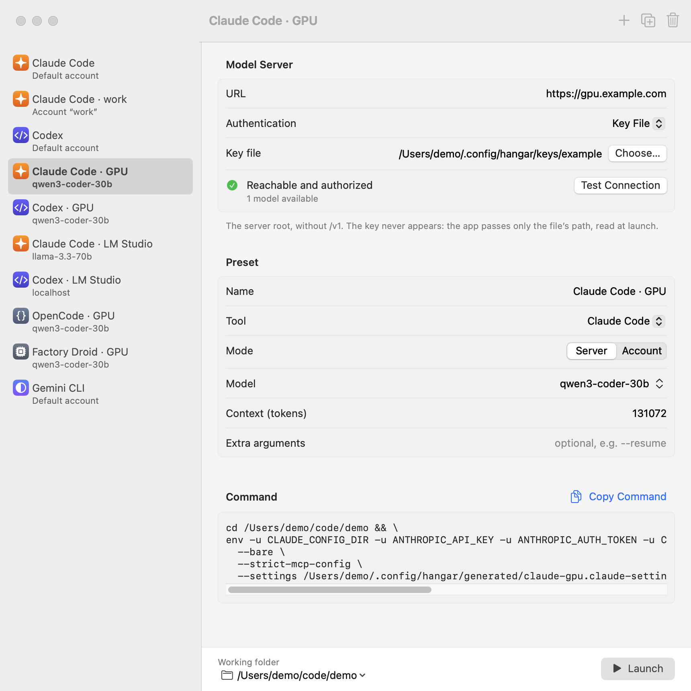

# Hangar

[](https://github.com/andreabasile/hangar/actions/workflows/ci.yml)

[](LICENSE)

Hangar is a small native macOS app that launches coding agents in your terminal from presets:
[Claude Code](https://docs.anthropic.com/en/docs/claude-code), [OpenAI Codex](https://github.com/openai/codex) and
seventeen more CLIs (see [Supported tools](#supported-tools)). A preset either uses the tool's own login (your default
account, or a separate one kept apart from it) or points the tool at a model server you choose: LM Studio,
llama-server, Ollama, or a GPU machine somewhere else. Hangar writes the settings each tool needs, checks
that the server answers, and opens a terminal in the folder you pick.

**Website:** [andreabasile.github.io/hangar](https://andreabasile.github.io/hangar/)

<picture>
  <source media="(prefers-color-scheme: dark)" srcset="docs/screenshot-dark.png">
  
</picture>

## Features

- **One window for every agent.** Each preset is one tool started one way; pick a folder and press ⌘↩.
- **Accounts kept apart.** Run a tool with your usual login, or give a preset a separate account with its own folder,
  so a work login and a personal one never mix.
- **Your own model server.** Point Claude Code, Codex and eleven other tools at LM Studio, llama-server, Ollama or a
  cloud GPU. Hangar checks the server, lists its models and keeps waiting while a pod is still loading.
- **Keys stay in their files.** Hangar passes the path of a key file; the key never shows up in arguments, generated
  files or the command preview.
- **Plain JSON config** you can edit by hand, reloaded as soon as you save it.
- **Terminal, Warp or any command** to open the session.
- **In English, French, German, Italian and Spanish.**

## Requirements

- macOS 15 or later.
- Xcode 27 or later to build (Swift 6.4). Older versions copy the String Catalogs instead of compiling them, so the
  app would have no translations and the tests fail.
- The tools you want on your shell's `PATH`. Hangar asks your shell where they are (as an interactive login shell,
  like a terminal), lists missing tools apart in the tool menu and shows their install command.
- For server presets, a model server that speaks the Anthropic Messages API (for Claude Code) or the OpenAI Responses
  API (for Codex). LM Studio and recent llama-server builds speak both.

## Install

With [Homebrew](https://brew.sh):

```sh
brew install --cask andreabasile/tap/hangar
```

Update it with `brew update && brew upgrade --cask hangar`. Or download the DMG from
[Releases](https://github.com/andreabasile/hangar/releases) and drag Hangar into Applications. The app is signed ad
hoc and not notarized: on first launch right-click it and choose Open (the Homebrew cask does this for you).

## Build from source

```sh
git clone https://github.com/andreabasile/hangar.git
cd hangar
./scripts/build-app.sh            # builds build/Hangar.app
./scripts/build-app.sh --install  # also copies it to /Applications and opens it
```

The app is signed ad hoc, which is enough to run it on the Mac that built it. To sign with your own identity, set
`HANGAR_SIGN_IDENTITY` to its name. `./scripts/release.sh X.Y.Z` tags a release: the release workflow builds the DMG,
publishes it and updates the cask in [andreabasile/homebrew-tap](https://github.com/andreabasile/homebrew-tap).

## Presets

Each preset in the sidebar is one way to start an agent: a tool, a mode, an optional model and extra arguments.

- **Account mode** runs the tool as you normally would, with its own login. *Default* is your usual account.
  *Separate* gives the account a name and its own folder, `~/.config/hangar/accounts/<tool>/<name>`: on first launch
  the tool asks you to sign in, and it starts without your usual settings, MCP servers and plugins. Presets with the
  same tool and account name share the login.
- **Server mode** points the tool at a model server: its root (`http://localhost:1234`, without `/v1`), its
  authentication (none, or a key file), the model alias and the context size in tokens. Presets with the same URL and
  key file share one connection check.

Hangar checks a server with `GET /v1/models` when you select a preset or change its URL; with a key file, only once
the URL is complete (on Return, when you leave the field, or on a paste), so the key never goes to a half-typed URL.
If the server is still starting
(a pod downloading its model, for example) it keeps checking every 10 seconds for up to 30 minutes. The models it
reports can be picked from the menu next to the model field. Choose the working folder in the bottom bar, then press
**Launch** (⌘↩).

### Keyboard shortcuts

| Shortcut | Action |
|---|---|
| ⌘N | New preset |
| ⌘D | Duplicate the preset |
| ⌫ | Delete the preset |
| ⌘L | Edit the server URL |
| ⌘R | Test the connection |
| ⇧⌘C | Copy the command |
| ⌘↩ | Launch |
| ⌘, | Settings: language, configuration folder, terminal |

### Config file

Presets live in `~/.config/hangar/config.json`. You can edit it by hand: Hangar reloads it when it changes and never
overwrites a file it cannot read.

```json
{
  "presets" : [
    {
      "account" : "work",
      "contextTokens" : 200000,
      "extraArgs" : "",
      "id" : "claude-work",
      "mode" : "account",
      "model" : "",
      "name" : "Claude Code · work",
      "tool" : "claude",
      "url" : ""
    },
    {
      "contextTokens" : 131072,
      "extraArgs" : "",
      "id" : "codex-gpu",
      "keyFile" : "~/.config/hangar/keys/gpu",
      "mode" : "server",
      "model" : "qwen3-coder-30b",
      "name" : "Codex · GPU",
      "tool" : "codex",
      "url" : "https://gpu.example.com"
    }
  ],
  "terminal" : {
    "customCommand" : "",
    "kind" : "warp"
  },
  "version" : 4
}
```

`tool` is one of `claude`, `codex`, `copilot`, `opencode`, `kilo`, `crush`, `qwen`, `goose`, `kimi`, `pi`, `vibe`,
`droid`, `aider`, `gemini`, `cursor`, `amp`, `kiro`, `cline` and `auggie`; `mode` is `account` or `server` (only the
modes a tool supports are used). In account mode, leave out `account` for the default
account. In server mode, leave out `keyFile` for a server without authentication. `terminal.kind` is `terminal`, `warp`
or `custom`.

## Supported tools

| Tool | Binary | Server | Separate accounts | Default account | Verified |
|---|---|---|---|---|---|
| Claude Code | `claude` | yes | yes | yes | yes |
| Codex | `codex` | yes | yes | yes | yes |
| GitHub Copilot CLI | `copilot` | yes | yes | yes | no |
| OpenCode | `opencode` | yes | yes | yes | no |
| Kilo CLI | `kilo` | yes | yes | yes | no |
| Crush | `crush` | yes | yes | yes | no |
| Qwen Code | `qwen` | yes | yes | yes | no |
| Goose | `goose` | yes | yes | yes | no |
| Kimi Code | `kimi` | yes | yes | yes | no |
| Pi | `pi` | yes | yes | yes | no |
| Mistral Vibe | `vibe` | yes | no | yes | no |
| Factory Droid | `droid` | yes, may still ask for a Factory login | no | yes | no |
| Aider | `aider` | yes | no | no | no |
| Gemini CLI | `gemini` | no | no | yes | no |
| Cursor CLI | `cursor-agent` | no | no | yes | no |
| Amp | `amp` | no | no | yes | no |
| Kiro CLI | `kiro-cli` | no | no | yes | no |
| Cline | `cline` | no | no | yes | no |
| Auggie | `auggie` | no | no | yes | no |

*Verified* means the command has been launched against a mock model server. The other tools follow their
documentation and source code; Hangar marks them as experimental.

In server mode every tool gets the server's root URL, with `/v1` added once for the tools that want it. Tools that need
a home of their own keep it in `~/.config/hangar/presets/<preset>/` (mode 700, config files 600). The key is read with
each tool's own hook where it has one (`{file:…}` for OpenCode and Kilo, `$(cat …)` inside Crush's config, `!cat …`
for Pi, a key command for Copilot); otherwise the generated script sets a variable from `$(cat <key file>)` at launch.
Tools that refuse to start without a key get the dummy `local` when the server has none.

### Install commands

| Tool | Command | Watch out |
|---|---|---|
| Claude Code | `curl -fsSL https://claude.ai/install.sh \| bash` | |
| Codex | `npm i -g @openai/codex` | |
| GitHub Copilot CLI | `npm i -g @github/copilot` | `gh copilot` is an older, different tool |
| OpenCode | `curl -fsSL https://opencode.ai/install \| bash` | the npm package is `opencode-ai` |
| Kilo CLI | `npm i -g @kilocode/cli` | |
| Crush | `brew install charmbracelet/tap/crush` | |
| Qwen Code | `npm i -g @qwen-code/qwen-code@latest` | needs Node 22 or later |
| Goose | `brew install block-goose-cli` | `brew install goose` is a database-migration tool |
| Kimi Code | `npm i -g @moonshot-ai/kimi-code` | needs Node 22.19 or later; the Python `kimi-cli` is archived |
| Pi | `npm i -g --ignore-scripts @earendil-works/pi-coding-agent` | `@mariozechner/pi-coding-agent` is deprecated |
| Mistral Vibe | `uv tool install --python 3.14 mistral-vibe` | or `brew install mistral-vibe` |
| Factory Droid | `npm i -g @factory/cli` | or `brew install --cask droid` |
| Aider | `uv tool install --python 3.12 aider-chat` | |
| Gemini CLI | `npm i -g @google/gemini-cli` | |
| Cursor CLI | `brew install --cask cursor-cli` | `--cask cursor` is the IDE |
| Amp | `npm i -g @ampcode/cli` | `brew install amp` is a text editor |
| Kiro CLI | `brew install --cask kiro-cli` | `--cask kiro` is the IDE |
| Cline | `npm i -g cline` | |
| Auggie | `npm i -g @augmentcode/auggie` | |

### Why some tools have no separate accounts

A separate account works when everything the tool keeps for a login lives in a folder Hangar can point it at.
Mistral Vibe, Cursor CLI, Gemini CLI, Amp, Kiro CLI, Cline and Auggie keep their credentials in Keychain items whose
names do not change with the folder, or can only be moved by changing `HOME`, which would move everything else too.
Two "accounts" would share one login, so Hangar offers them only with your default account. Factory Droid is the same,
and Aider has no login at all. For Gemini CLI, never save an API key through `/auth`: that Keychain entry is shared.

### Known side effects

Some tools still write under your home folder whatever Hangar sets:

- GitHub Copilot CLI writes to `~/Library/Caches` unless `COPILOT_CACHE_HOME` is set (Hangar sets it in server mode and
  for separate accounts).
- OpenCode reads `~/.config/opencode` and writes `~/.cache/opencode`, in every mode.
- Aider always writes `~/.aider`.
- Mistral Vibe writes its logs to `~/.vibe/logs`.

## Terminals

- **Terminal.app**: opens the generated `.command` script. No Automation permission is needed.
- **Warp**: writes a Tab Config per preset to `~/.warp/tab_configs/hangar_<preset>.toml` and opens it in a new window
  with `warp://tab_config/…`. These configs also appear in Warp's `+` menu.
- **Custom command**: any command, run with `/bin/sh`. `{script}` is replaced by the generated script and `{dir}` by
  the working folder, both shell-quoted. The command must return at once, and `/bin/sh` has no Homebrew `PATH`, so use
  absolute paths. For example, `/opt/homebrew/bin/tmux new-window -c {dir} {script}`.

## Security notes

- The key is read from its file at launch time and never written into any file Hangar creates, nor into an environment
  variable: Codex gets it from its provider's auth command and Claude Code from an `apiKeyHelper`, both running
  `cat <key file>`. The command preview and "Copy Command" show only the file path.
- Generated scripts and settings live in `~/.config/hangar/generated/` (mode 700). The command drops
  `ANTHROPIC_API_KEY`, `ANTHROPIC_AUTH_TOKEN` and the `CLAUDE_CODE_USE_BEDROCK/VERTEX/FOUNDRY` switches from the tool's
  environment, so a key exported by your shell is never sent to the model server.
- Claude Code runs with `--bare --strict-mcp-config`: no hooks, plugins, MCP servers or `CLAUDE.md` auto-discovery from
  your normal setup.
- Codex runs with its own `CODEX_HOME` (`~/.config/hangar/codex-home`) and never touches `~/.codex`, so your MCP
  servers, plugins, hooks and `AGENTS.md` are not loaded. On every run Hangar also passes `-c` overrides that turn off
  computer use, the browser tools, plugins, hooks, apps, multi-agent and web search, the global skills instructions,
  analytics, feedback and the update check. Only function tools are sent, which local servers accept.
- Without authentication, Codex sends no key; Claude Code receives the dummy key `local`, because it refuses to start
  without one.
- Account mode runs the tool with its usual login and features. The default account runs with `CLAUDE_CONFIG_DIR` or
  `CODEX_HOME` removed from the environment (Claude keys its Keychain item on any value it is given, even `~/.claude`),
  so an inherited value cannot switch accounts. A separate account's folder (mode 700) is always passed as the same
  absolute path.

## Development

```sh
swift test                         # unit tests (HangarCore)
swift run Hangar                   # run from source, in English
swift run Hangar --snapshot <dir>  # render the main views to PNG, from a built-in sample config
```

The code is split in two targets: `HangarCore` (tools, launch recipes, config, connection checks, terminal launch;
everything that is tested) and `Hangar` (the SwiftUI app). `docs/` holds the screenshots and the website, served by
GitHub Pages.

## Languages

The app is in English, French, German, Italian and Spanish. It follows the system language unless you pick one in
Settings › General (the same choice as System Settings › General › Language & Region › Applications); other languages
fall back to English. The strings live in two String Catalogs, `Sources/HangarCore/Localizable.xcstrings` and
`Sources/Hangar/Localizable.xcstrings`, each key in every language; a test fails if one lacks a translation or
changes a placeholder. SwiftPM compiles them; `scripts/build-app.sh` puts them in the app. To see the app, or the
snapshots, in one language:

```sh
open build/Hangar.app --args -AppleLanguages '(it)'
build/Hangar.app/Contents/MacOS/Hangar --snapshot <folder> -AppleLanguages '(en)'
```

`swift run` alone always shows English, since the bare binary carries no translations of its own.

## Contributing

Issues and pull requests are welcome. For a new tool, add it to `Tool` and its launch recipe in `Commands.swift`, with
a test in `ToolTemplateTests`; for a new language, add it to both String Catalogs and to `CFBundleLocalizations` in
`Resources/Info.plist`. Run `swift test` before opening a pull request.

## License

MIT, see [LICENSE](LICENSE).

Hangar is not affiliated with Anthropic, OpenAI or the makers of the other tools it launches; their names and
trademarks belong to their owners.
